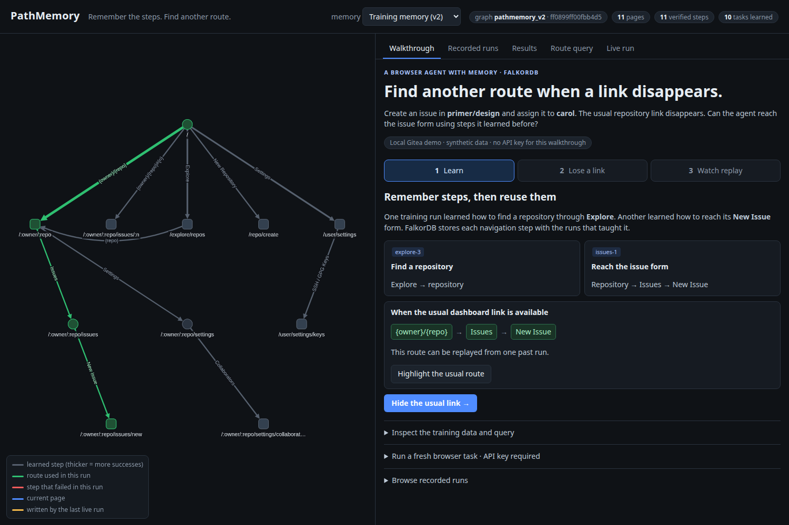
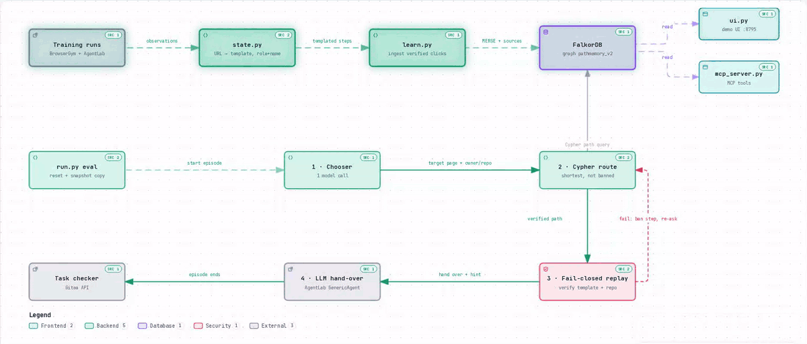
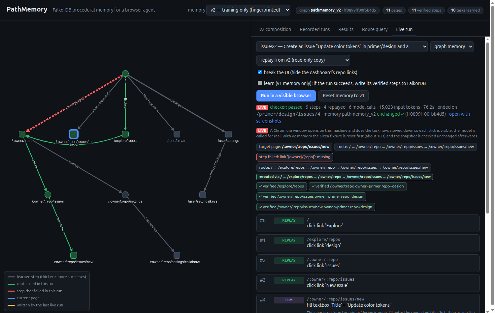

# PathMemory

**FalkorDB procedural memory for browser agents: verified UI steps from separate past runs, composed by a graph
query into a route no single run took, replayed in a real browser with every page and entity checked.**

Graph Hacks (WeMakeDevs × FalkorDB), October 2026. **Tracks entered: 01 — Agents That Act on Connected Data
(primary: the graph decides and verifies the agent's browser actions); 02 — Agent Memory and Coordination
(secondary: persistent procedural memory shared across tasks and sessions).** This is a single agent; no
multi-agent coordination is claimed.


*The v2 tab: the route FalkorDB returns when the dashboard link is gone (green), the banned step (red dashed),
and for each hop the training run that taught it. Gold badges are hops only one run taught.*

## The problem

A browser agent re-derives the same navigation on every task: open the repository, find Issues, find New Issue.
Each of those clicks costs a model call. Agents that keep memory usually keep **trajectories**: whole past runs,
retrieved by similarity and pasted into the prompt, or replayed as a script.

## Why past trajectories alone do not supply a new route

A trajectory is one path from one start to one end. When the page the agent starts from changes (here: the
dashboard stops showing repository links), the stored trajectory that began with "click the repo on the
dashboard" is dead, and the knowledge needed to get around it is spread over runs that were about something else.
In our training memory, one run (`explore-3`) went **dashboard → Explore → a repository**, and another (`issues-1`)
went **dashboard → repository → Issues → New Issue**. Neither contains **Explore → repository → Issues → New Issue**,
and no amount of trajectory retrieval produces a run that does not exist.

## How FalkorDB composes the route

PathMemory stores what runs *verified*, one step at a time, as a graph:

- **Pages are templates** (`/:owner/:repo/issues`), so a step learned on one repository applies to all of them.
- **Steps are verified clicks** `(:State)-[:ACT]->(:State)`, identified by element role + accessible name + page
  landmark, with entity names templated (`link '{repo}'`), success/failure counts, and the **training runs that
  showed them** (`r.sources`).
- **A route is a Cypher path query** over all steps from all runs. When a step fails, it is banned for this run and
  the query is asked again. The answer can join steps from different runs at a shared page template: here
  `Explore` (explore-1, explore-3) → `{repo}` (explore-3) → `Issues` → `New Issue` (issues-1).

## How the browser verifies actions

Memory only replays navigation (links, tabs, menu items); the LLM makes every data-changing decision. Replay is
fail-closed:

- a click happens only on **one visible element** with the stored role and name, inside the stored landmark;
  hidden, out-of-landmark or ambiguous targets (same name, different link) are never clicked;
- if the link's href already points to a **different owner/repo** than the task needs, it is refused before clicking;
- after each click the new page must have the **expected template and the chosen owner/repo**;
- on any failure the step is banned for this run and FalkorDB is asked for another route; with none left, the LLM
  continues from the current page. Evaluation never writes to memory.

## Why the ablation matters

Removing the one bridge step (`/explore/repos → {repo}`, taught only by explore-3) from a copy of the graph removes
the composed route: the same query returns nothing and replay falls back to the LLM. That isolates the effect to the
**graph join**: same chooser, same matcher, same checks, one edge less. A single-trajectory replay baseline with
the same machinery (flat replay) fails the same way. The base LLM still completes the task without the join (it
finds its own way through the UI); what is lost is the agent's ability to reach the page by **verified replay of
steps learned in other episodes**, without spending model calls on navigation.

## Results (v2, 2026-10-18)

One held-out task (`issues-2`: create an issue in primer/design and assign carol), dashboard repository links
hidden, `gpt-6-luna`, 5 trials per mode. A focused demonstration, not a benchmark
([FAIR_COMPARISON.md](docs/evidence/v2/FAIR_COMPARISON.md)).

> **Graph-composed replay reached the target page in 5/5 broken-UI trials; single-trajectory flat replay in 0/5;
> the graph with the bridge step removed in 0/5.**

| dashboard links hidden | No memory | Flat prompt (top-3) | Flat replay (one trajectory) | **Graph** | Graph, bridge removed |
|---|---|---|---|---|---|
| final task checker passed | 5/5 | 5/5 | 5/5 | 5/5 | 5/5 |
| memory replay reached the target page | – | – | 0/5 | **5/5** | 0/5 |
| model calls / task (chooser + base, incl. retries) | 7.0 | 7.6 | 8.4 | **6.0** | 8.4 |
| input tokens / task | 20.6k | 25.4k | 23.7k | **15.0k** | 24.9k |
| est. USD / task | 0.0023 | 0.0029 | 0.0027 | **0.0017** | 0.0028 |
| browser actions / task | **7.0** | 7.6 | 7.4 | 9.0 | 7.4 |

- **Every mode passed the checker every time: there is no task-success advantage.** Where the graph differs is
  that it got there by replay, at lower model cost. No latency advantage (episode times 32.8–36.7 s) and no
  significance test.
- **No memory used fewer browser actions.** The break hides only exact `owner/repo` links; the activity feed still
  links issues (`primer/design#1`), and the LLM went issue page → "New Issue" button in 2 clicks. Memory cannot
  learn that shortcut (it stores navigation links, and that control is a button), so it replays 4 hops.
- **Normal UI:** flat replay ties graph (both replay the single issues-1 route; 6.0 calls, $0.0017).
- **Flat prompt fairness:** its top-3 retrieval did not include explore-3 or issues-1. Pinning exactly the route's
  three source runs into its prompt did not change its path or cost (7.8 calls; still the feed shortcut).
- Cost: litellm 1.80.0 list price for `gpt-6-luna` ($0.10 / 1M input, $0.50 / 1M output), no cache discount.

Evidence: [COMPOSITION.md](docs/evidence/v2/COMPOSITION.md) (episodes, route, per-hop sources, Cypher result,
absence from every single run), [DEMO_WALKTHROUGH.md](docs/evidence/v2/DEMO_WALKTHROUGH.md) (screenshots),
raw rows in [docs/evidence/v2/runs/](docs/evidence/v2/runs/), training manifest with hashes in
[docs/evidence/v2/memory/](docs/evidence/v2/memory/).

## Graph data model

```
(:State {key, route, title})                          page template, e.g. "/:owner/:repo/issues?state=closed"
(:State)-[:ACT {eid, kind, role, name, scope, pre,    verified navigation click: role + accessible name (entities
               successes, failures, sources}]->(:State)  templated "{owner}/{repo}"), landmark scope, prerequisite
                                                      clicks (e.g. open a menu), outcome counts, source runs
(:Task {id, goal, cluster})-[:WORKED_AT {steps}]->(:State)
                                                      where a past task did its real work, and what it did there
```

v2 memory: graph `pathmemory_v2` (11 pages, 11 steps, 10 tasks, fingerprint `ff0899ff00fbb4d5`) on FalkorDB
(Docker, port 6391; browser UI http://localhost:3391).

### Cypher the product depends on

All in `src/pathmemory/graph.py`, all parameterised.

```cypher
// route: shortest verified path avoiding steps that failed in this run, least-failed first
MATCH (a:State {key:$src}), (b:State {key:$dst})
MATCH p = (a)-[:ACT*1..6]->(b)
WHERE all(r IN relationships(p) WHERE r.successes > 0 AND NOT r.eid IN $banned)
RETURN [n IN nodes(p) | n.key] AS keys,
       [r IN relationships(p) | [r.eid, r.kind, r.role, r.name, r.pre, r.scope, r.sources]] AS edges,
       length(p) AS hops, reduce(f = 0, r IN relationships(p) | f + r.failures) AS fails
ORDER BY hops, fails LIMIT $k

// learn a verified step; outcome counts accumulate across runs
MATCH (a:State {key:$src}), (b:State {key:$dst})
MERGE (a)-[r:ACT {eid:$eid}]->(b)
ON CREATE SET r.kind=$kind, r.role=$role, r.name=$name, r.scope=$scope, r.pre=$pre, r.successes=0, r.failures=0
SET r.successes = r.successes + $s, r.failures = r.failures + $f

// provenance: remember which training run showed the step (once per run)
MATCH ()-[r:ACT {eid:$eid}]->()
SET r.sources = CASE WHEN r.sources IS NULL THEN [$src] WHEN $src IN r.sources THEN r.sources ELSE r.sources + $src END

// destinations offered to the chooser: every page, with the goals of past tasks done there
MATCH (s:State) OPTIONAL MATCH (t:Task)-[w:WORKED_AT]->(s)
RETURN s.key, s.title, collect(t.goal), collect(w.steps) ORDER BY s.key

// live learning only (never in evaluation): a remembered step broke
MATCH ()-[r:ACT {eid:$eid}]->() SET r.failures = r.failures + 1
```

## Architecture



```
 BrowserGym observation ──► state.py: URL → page template; element → (role, name, landmark); entities → {owner}/{repo}
                                │
 learn.py  successful training runs ──► (:State)-[:ACT {…, sources}]->(:State), (:Task)-[:WORKED_AT]->(:State)   FalkorDB
           (manifest: run ids, task/goal/file hashes, graph fingerprint)
                                ▼
 agent.py (wraps AgentLab GenericAgent; modes none | flat | flatreplay | graph)
   1. chooser (1 model call): which known page does the goal need, which owner/repo?
   2. Cypher route from the current page (flatreplay: a stretch of one stored run instead)
   3. replay clicks without the LLM; fail-closed target match; verify page template + owner/repo after each click;
      on failure ban the step for this run and query again
   4. hand over to the LLM (forms, buttons, the answer) with a note on where replay ended
 run.py   eval: fixture reset + fingerprint and a fresh copy of the memory snapshot before every trial
 ui.py    demo UI (live and recorded runs, live Cypher)     mcp_server.py  the same memory as MCP tools
```

## Quick start (local; no hosted deployment)

Needs Docker, [uv](https://docs.astral.sh/uv/) and, for runs with the model, an OpenAI API key.

```bash
git clone https://github.com/purnasai/pathmemory && cd pathmemory
scripts/reproduce_v2.sh             # services, fixture, v2 memory + provenance, composed route, ablation: no API key
cp .env.example .env                # add OPENAI_API_KEY (and OPENAI_MODEL=gpt-6-luna)
scripts/reproduce_v2.sh --with-llm  # + one composed-route run and one ablated run in the browser (~$0.005)
uv run pathmemory-ui                # demo UI: http://localhost:8795
uv run pytest -q                    # unit + integration tests (integration needs the containers)
```

Step-by-step commands and expected output: [docs/evidence/v2/REPRODUCE.md](docs/evidence/v2/REPRODUCE.md).

### Demo UI (`uv run pathmemory-ui`, http://localhost:8795)

- **v2 composition** (default): training runs, the route FalkorDB returns *now* for the normal UI, with the dashboard
  step banned, and on the ablated graph (live queries), per-hop source runs, and buttons that run the task **live**
  in a visible Chromium window from a read-only copy of v2 or of the ablated graph.
- **Recorded runs**: any saved run step by step with screenshots, labelled RECORDED with its run directory.
- **Results**: all experiment tables, v1 historical and v2. **Route query**: pick pages, mark steps broken, watch the
  route change. **Live run**: the live runs; the status line says whether memory replay reached the target page or
  the checker passed by LLM fallback, and that the memory snapshot was unchanged.
- The header's memory selector switches the graph between v2, v2 ablated and v1 (historical demo memory, the only
  one live learning can write to).



## Historical results v1 (2026-10-16, as recorded; see corrections)

> v1 memory included a repair episode of `members-2`, a test task, so the v1 "after one repair episode" rows are not
> held-out results. v2 replaces that with a training-only memory.

> **Correction (2026-10-18):** the "LLM calls" columns below count LLM-chosen browser steps, not model calls. Counting the destination chooser and parse retries, graph mode made **more** model calls than no memory on the normal UI (4.64 vs 4.21 per task); the input-token savings stand. `repos-5` was run twice with different goals. v1 evaluation also wrote failure counts to its own memory and did not reset the site before read-only tasks. Details and corrected numbers: [docs/evidence/v1-derived/CORRECTIONS.md](docs/evidence/v1-derived/CORRECTIONS.md).

| Experiment | No memory | Flat memory (top-3 past trajectories in prompt) | **PathMemory (graph)** |
|---|---|---|---|
| Normal UI, 14 held-out tasks — success | 14/14 | 14/14 | 13/14 |
| — avg input tokens | 13.9k | 16.6k | **10.3k (−26%)** |
| — avg LLM calls | 4.1 | 4.3 | **3.5** |
| UI break, after one repair episode (4 tasks) — success | – | 4/4 | 3/4 |
| — avg input tokens | – | 36.4k | **15.5k** |

The table is kept as recorded. Its "LLM calls" are LLM-chosen browser steps; counting the chooser and retries,
v1 graph mode made more model calls than no memory, and the UI-break rows used memory that contained a test-task
episode. See the correction notes above.

### Reproducing v1 (historical; about 1 hour)

v1 memory included a test-task repair episode; kept only to reproduce the recorded v1 numbers.

```bash
uv run python -m pathmemory.run learn --tag v1                       # 8 training tasks -> memory
uv run python -m pathmemory.run eval --tag v1                        # 14 held-out tasks x {none, flat, graph}
uv run python -m pathmemory.run learn explore-1 explore-2 --keep --tag v1-alt
uv run python -m pathmemory.run recovery --tag v1                    # dashboard repo links hidden, before repair
# rebuild memory = training runs + one repair episode (the no-memory run that found a way around the break)
uv run python -m pathmemory.run ingest results/v1/learn/* results/v1-alt/learn/* \
    results/v1/recovery/*PathMemory-none_on_pathmemory.members-2_0
uv run python -m pathmemory.run recovery members-4 issues-2 issues-5 repos-3 --modes flat graph --tag v1-repaired
uv run python -m pathmemory.report results/v1/eval.jsonl --select both
```


## MCP server

Any MCP client can use the memory. `.mcp.json` registers it for Claude Code.

```bash
uv run pathmemory-mcp       # stdio
```

| Tool | Does |
|---|---|
| `list_pages` | known page templates and what past tasks did there |
| `resolve_url` | concrete URL → template + placeholder values |
| `page_memory` | past work on a page and the verified clicks leaving it |
| `find_route` | up to 3 verified routes, optionally avoiding broken steps |
| `record_step` | teach one verified navigation click (links/tabs/menu items only) |
| `report_failure` | mark a remembered step as failed |

Fixed, parameterised Cypher only; no tool accepts Cypher. `tests/test_mcp.py` runs the full
route → break → teach → recompose story over stdio.

## Evidence and persistence

v2 evidence: `docs/evidence/v2/` (see links above). The v1 run logs are committed in `docs/evidence/` (JSONL summaries; screenshots and step pickles
stay in the git-ignored `results/`). Recompute any table without re-running the agent:

```bash
uv run python -m pathmemory.report docs/evidence/v1/eval.jsonl --select both  # normal UI, 14 tasks x 3 modes
uv run python -m pathmemory.report docs/evidence/v1/recovery.jsonl --select both  # UI break, before repair
uv run python -m pathmemory.report docs/evidence/v1-repaired/recovery.jsonl --select both # UI break, after one repair episode
```

Re-running the experiments with the LLM gives different numbers run to run (`gpt-6-luna` only accepts
temperature 1); `docs/evidence/v1-repeat*` are two repeats of `repos-3` (one failed before the hint fix, one
passed after it).

**Persistence across sessions** (v1 memory, checked 2026-10-18, `docs/evidence/persistence/`): one process queried the
memory (11 page templates, 11 verified steps, 10 task worksites) and found the reroute
`/ → Explore → {repo} → Settings → Collaborators` around the broken dashboard step; FalkorDB was saved and the
container restarted; a new process got the same counts and the same route. The memory lives in FalkorDB, not in
the agent process. The compose file has no volume, so `docker compose down` deletes the memory; `restart`, stop
and start keep it.

## Layout

```
src/pathmemory/
  state.py            page templates, semantic steps, fail-closed element lookup
  graph.py            FalkorDB schema + queries, provenance, fingerprint, dump/load, migration
  learn.py            successful runs -> graph + flat store; build_memory (manifest)
  agent.py            PathMemory agent (none / flat / flatreplay / graph)
  run.py              build-memory / ablate / eval / live (isolated snapshots, fixture reset per trial)
  composition.py      composed-route evidence; repro.py  reproduction checks; probe.py  no-LLM browser probes
  compare.py, report.py, accounting.py, replaycheck.py, migration_check.py, provenance.py   evidence tools
  service.py, ui.py, static/   demo UI;  mcp_server.py  MCP tools;  site/  Gitea fixture + BrowserGym tasks
docs/evidence/        v1 (as recorded), v1-derived (corrections), v2 (current evidence)
scripts/reproduce_v2.sh
```

## AI assistance disclosure

This project was built with an AI coding assistant (Claude Code). The author reviewed, tested and can explain every part: graph model, route query, replay and evaluation.

## Limits

One self-built Gitea site with synthetic data, one model, one composition case, 5 trials per cell; not WebArena
and not comparable to any leaderboard. The model completes these tasks without memory, so what memory changes is how
the agent gets there and what it costs. The UI break is partial (the activity feed still links issues).
Corrections to the v1 results: [docs/evidence/v1-derived/CORRECTIONS.md](docs/evidence/v1-derived/CORRECTIONS.md).
