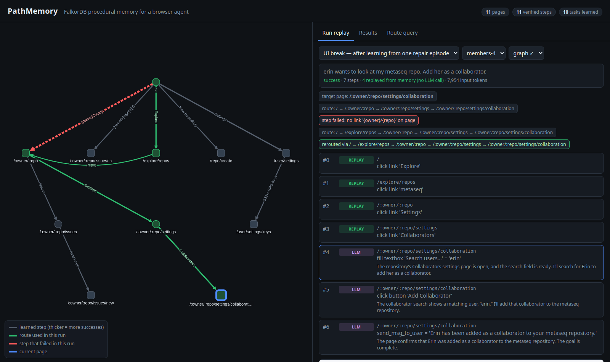

# PathMemory

**FalkorDB procedural memory for browser agents: remember how a website works, reuse it on new tasks,
and route around steps that break.**

Graph Hacks (WeMakeDevs × FalkorDB), October 2026. **Tracks entered: 01 — Agents That Act on Connected Data;
02 — Agent Memory and Coordination** (procedural memory that persists across tasks and sessions).

Browser agents rediscover the same navigation on every task: open the repo, find Settings, find Collaborators.
Every one of those clicks is an LLM call. PathMemory stores what the agent has *verified* about a site as a graph
in FalkorDB and lets later tasks reuse it:

- **Pages are templates.** `/byteblaze/dotfiles/settings/collaboration` and `/primer/design/settings/collaboration`
  are the same node, `/:owner/:repo/settings/collaboration`, so a route learned on one repo works on every repo.
- **Steps are verified clicks.** An edge exists only if clicking that element (by role + accessible name, e.g.
  link `Settings`, link `{repo}`) actually led to the next page. Edges count successes and failures.
- **Routes are graph queries.** A bounded variable-length Cypher match finds the shortest, least-failed path,
  so a route can combine steps learned in different tasks.
- **Replay without the LLM, check every page.** Navigation clicks are replayed directly; the page after each click
  must match the expected template. If a step fails, it is banned for the run, recorded as a failure, and
  FalkorDB is asked for another route.
- **The LLM still does the real work.** Memory only replays navigation (links, tabs, menu items). Anything that
  changes data — filling forms, pressing buttons — is always the LLM's decision.


*A held-out task with the UI broken: the remembered dashboard link is gone (red). FalkorDB reroutes through
Explore (green), a route verified by one earlier repair run; 4 clicks are replayed with no LLM call, then the
LLM adds the collaborator.*

## Results (local Gitea, `gpt-6-luna`, same agent/prompt/budget in every mode)

> **Correction (2026-10-18, branch `p0-correctness`):** the "LLM calls" columns below count LLM-chosen browser steps, not model calls. Counting the destination chooser and parse retries, graph mode made **more** model calls than no memory on the normal UI (4.64 vs 4.21 per task); the input-token savings stand. `repos-5` was run twice with different goals. v1 evaluation also wrote failure counts to its own memory and did not reset the site before read-only tasks. Details and corrected numbers: [docs/evidence/v1-derived/CORRECTIONS.md](docs/evidence/v1-derived/CORRECTIONS.md).

| Experiment | No memory | Flat memory (top-3 past trajectories in prompt) | **PathMemory (graph)** |
|---|---|---|---|
| Normal UI, 14 held-out tasks — success | 14/14 | 14/14 | 13/14 |
| — avg input tokens | 13.9k | 16.6k | **10.3k (−26%)** |
| — avg LLM calls | 4.1 | 4.3 | **3.5** |
| UI break, after one repair episode (4 tasks) — success | – | 4/4 | 3/4 |
| — avg input tokens | – | 36.4k | **15.5k** |

- Flat memory makes prompts bigger and saves nothing; the graph turns memory into skipped LLM calls.
- Under a UI break the graph detected the dead step on every task and rerouted. On `members-4` (which no mode
  could solve before the repair) it took 7 steps / 8k tokens vs. flat memory's 14 steps / 73.5k.
- With this model, memory changes **cost**, not success. Samples are small and on one self-built site —
  see [RESULTS.md](RESULTS.md) for every number, failure analysis and limits.

## Graph data model

```
(:State {key, route, title})                         a page template, e.g. key "/:owner/:repo/issues?state=closed"
(:State)-[:ACT {eid, kind, role, name, scope, pre,   a verified navigation click: element role + accessible name
               successes, failures}]->(:State)       (entities templated: "{owner}/{repo}"), landmark scope,
                                                     prerequisite clicks (e.g. open a dropdown), outcome counts
(:Task {id, goal, cluster})-[:WORKED_AT {steps}]->(:State)
                                                     where a past task did its real work, and what it did there
```

Graph `pathmemory` on FalkorDB (Docker, port 6391). Browse it at http://localhost:3391.

### Cypher the product depends on

All in `src/pathmemory/graph.py`, all parameterised.

```cypher
// route finding: shortest verified path that avoids banned (failed) steps, least-failed first
MATCH (a:State {key:$src}), (b:State {key:$dst})
MATCH p = (a)-[:ACT*1..6]->(b)
WHERE all(r IN relationships(p) WHERE r.successes > 0 AND NOT r.eid IN $banned)
RETURN [n IN nodes(p) | n.key] AS keys,
       [r IN relationships(p) | [r.eid, r.kind, r.role, r.name, r.pre, r.scope]] AS edges,
       length(p) AS hops, reduce(f = 0, r IN relationships(p) | f + r.failures) AS fails
ORDER BY hops, fails LIMIT $k

// learn a verified step (outcome counts accumulate across runs)
MATCH (a:State {key:$src}), (b:State {key:$dst})
MERGE (a)-[r:ACT {eid:$eid}]->(b)
ON CREATE SET r.kind=$kind, r.role=$role, r.name=$name, r.scope=$scope, r.pre=$pre, r.successes=0, r.failures=0
SET r.successes = r.successes + $s, r.failures = r.failures + $f

// a remembered step broke
MATCH ()-[r:ACT {eid:$eid}]->() SET r.failures = r.failures + 1

// where past tasks did their work (shown to the destination chooser)
MERGE (t:Task {id:$id}) SET t.goal=$goal, t.cluster=$cluster
WITH t MATCH (s:State {key:$key}) MERGE (t)-[w:WORKED_AT]->(s) SET w.steps=$steps

MATCH (s:State) OPTIONAL MATCH (t:Task)-[w:WORKED_AT]->(s)
RETURN s.key, s.title, collect(t.goal), collect(w.steps) ORDER BY s.key
```

Why a graph and not a list of saved trajectories: two of the four recovered routes (`issues-2`, `issues-5`)
combine edges from three different tasks (`Explore` from `explore-1`, `Explore → {repo}` from a repair run,
`{repo} → Issues → New Issue` from `issues-1`) and exist in no stored trajectory; the graph query assembles
them. The other two (`members-4`, `repos-3`) follow a route the repair run contains in full; there the gain is
replay without the LLM, since flat memory had the same trajectory. Failure counts on shared edges affect every
future route through them. Remove FalkorDB and graph mode has nothing to replay. Per-hop provenance:
`uv run python -m pathmemory.provenance` → `results/v1-repaired/provenance.json`.

## How it works

```
 BrowserGym observation ──► state.py: URL → page template, element → (role, name, landmark), entities → {owner}/{repo}
                                │
 learn.py (successful runs) ───►│ (:State)-[:ACT {name, pre, successes, failures}]->(:State)
                                │ (:Task)-[:WORKED_AT {steps}]->(:State)            FalkorDB
                                ▼
 agent.py (wraps AgentLab GenericAgent)
   1. one LLM call: which known page does this goal need, and which owner/repo?
   2. Cypher: shortest verified route from the current page            ──► find_route
   3. replay clicks (no LLM), check each page; on failure ban the edge,
      record it, ask FalkorDB for another route                       ──► report_failure
   4. hand over to the LLM with what past tasks did on that page
```

Baselines use the same hint channel and the same frozen memory input, so the comparison is about the memory
structure, not about who saw more data.

## Quick start (local; no hosted deployment)

Needs Docker, [uv](https://docs.astral.sh/uv/), and an OpenAI API key. Downloads are small (Gitea ≈150 MB,
FalkorDB ≈700 MB, Chromium). Full reproduction costs well under $1 in API calls with `gpt-6-luna`.

```bash
git clone https://github.com/purnasai/pathmemory && cd pathmemory
cp .env.example .env                                   # add OPENAI_API_KEY (and OPENAI_MODEL)
uv sync && uv run playwright install chromium
docker compose up -d                                   # FalkorDB :6391 (browser UI :3391), Gitea :3300
uv run python -m pathmemory.site.seed --reset          # ~9 s: recreate and seed Gitea
uv run pytest -q                                       # 10 tests (needs FalkorDB)
uv run pathmemory-ui                                   # demo UI on saved runs: http://localhost:8795
```

Reproduce the experiments (about 1 hour, runs one browser at a time):

```bash
uv run python -m pathmemory.run learn --tag v1                       # 8 training tasks -> memory
uv run python -m pathmemory.run eval --tag v1                        # 14 held-out tasks x {none, flat, graph}
uv run python -m pathmemory.run learn explore-1 explore-2 --keep --tag v1-alt
uv run python -m pathmemory.run recovery --tag v1                    # dashboard repo links hidden, before repair
# rebuild memory = training runs + one repair episode (the no-memory run that found a way around the break)
uv run python -m pathmemory.run ingest results/v1/learn/* results/v1-alt/learn/* \
    results/v1/recovery/*PathMemory-none_on_pathmemory.members-2_0
uv run python -m pathmemory.run recovery members-4 issues-2 issues-5 repos-3 --modes flat graph --tag v1-repaired
uv run python -m pathmemory.report results/v1/eval.jsonl --select both
```

The demo UI reads `results/`, which is not committed (screenshots and step logs are large); run the experiments
first, or use the screenshots in `docs/`.

Gitea login: `byteblaze` / `hackathon123`. 24 tasks in 6 groups live in `src/pathmemory/site/tasks.py`, each
checked deterministically (Gitea API state, final URL, or the agent's answer).

### Demo UI

```bash
uv run pathmemory-ui        # http://localhost:8795
```

- **Run replay**: any saved run step by step — screenshot, LLM vs. replayed steps, failed step and reroute
  highlighted on the graph.
- **Results**: all three experiments; click any cell to replay that run.
- **Route query**: pick two pages, tick steps to treat as broken, and watch FalkorDB find a different route
  (with the Cypher it runs).
- **Live run**: pick a task and a memory mode (optionally break the UI) and press Run. A visible Chromium window
  does the task, slowed down, while the steps and the graph highlighting update live. With **learn** ticked, a
  successful run writes back to FalkorDB as it finishes (same rule as the experiments: only verified clicks from
  successful runs): new steps, steps confirmed again, steps that failed, and the task's worksite. The UI lists the
  write and highlights it on the graph in yellow. The experiments' memory is copied to graph `pathmemory_v1` before
  the first live write; **Reset memory to v1** (or `uv run python -m pathmemory.run restore-memory`) puts it back.
  Needs a desktop session and an OpenAI key.

### MCP server

Any MCP client can use the memory. `.mcp.json` registers it for Claude Code.

```bash
uv run pathmemory-mcp       # stdio
```

| Tool | Does |
|---|---|
| `list_pages` | known page templates and what past tasks did there |
| `resolve_url` | concrete URL → template + placeholder values |
| `page_memory` | past work on a page and the verified clicks leaving it |
| `find_route` | up to 3 verified routes, optionally avoiding broken steps |
| `record_step` | teach one verified navigation click (links/tabs/menu items only) |
| `report_failure` | mark a remembered step as failed |

Fixed, parameterised Cypher only; no tool accepts Cypher. `tests/test_mcp.py` runs the full
route → break → teach → recompose story over stdio.

## Evidence and persistence

The run logs behind every table are committed in `docs/evidence/` (JSONL summaries; screenshots and step pickles
stay in the git-ignored `results/`). Recompute any table without re-running the agent:

```bash
uv run python -m pathmemory.report docs/evidence/v1/eval.jsonl --select both  # normal UI, 14 tasks x 3 modes
uv run python -m pathmemory.report docs/evidence/v1/recovery.jsonl --select both  # UI break, before repair
uv run python -m pathmemory.report docs/evidence/v1-repaired/recovery.jsonl --select both # UI break, after one repair episode
```

Re-running the experiments with the LLM gives different numbers run to run (`gpt-6-luna` only accepts
temperature 1); `docs/evidence/v1-repeat*` are two repeats of `repos-3` (one failed before the hint fix, one
passed after it).

**Persistence across sessions** (checked 2026-10-18, `docs/evidence/persistence/`): one process queried the
memory (11 page templates, 11 verified steps, 10 task worksites) and found the reroute
`/ → Explore → {repo} → Settings → Collaborators` around the broken dashboard step; FalkorDB was saved and the
container restarted; a new process got the same counts and the same route. The memory lives in FalkorDB, not in
the agent process. The compose file has no volume, so `docker compose down` deletes the memory; `restart`, stop
and start keep it.

## Layout

```
src/pathmemory/
  state.py        page templates, semantic steps, element lookup
  graph.py        FalkorDB schema + queries
  learn.py        successful runs -> graph + flat store
  agent.py        PathMemory agent (none / flat / graph)
  run.py          learn / eval / recovery experiments
  service.py      shared API for UI + MCP
  ui.py, static/  demo UI
  mcp_server.py   MCP tools
  provenance.py   audit: which saved episode taught each hop of a replayed route
  site/           Gitea seed data and BrowserGym tasks
```

## AI assistance disclosure

Built with AI coding assistants, as the rules allow:

- **ChatGPT** was used to brainstorm and critique ideas, the architecture and the evaluation design.
- **Claude Code (Claude Opus 5.5)** wrote most of the code, tests and docs, and ran the experiments, under my
  direction. I chose the problem and the constraints (no large benchmark downloads, no employer-domain data,
  fair baselines), reviewed each design decision (route templates, replaying only navigation, the shared
  hint channel for baselines, the recovery protocol), and decided how to report the results, including the
  failures.
- All results in this repo come from real runs; nothing was edited by hand.

## Limits

One site, one model, small samples, a UI break I chose; not WebArena and not comparable to any leaderboard.
The model succeeds on nearly every task without memory, so the measured gain is efficiency. Details in
[RESULTS.md](RESULTS.md).
