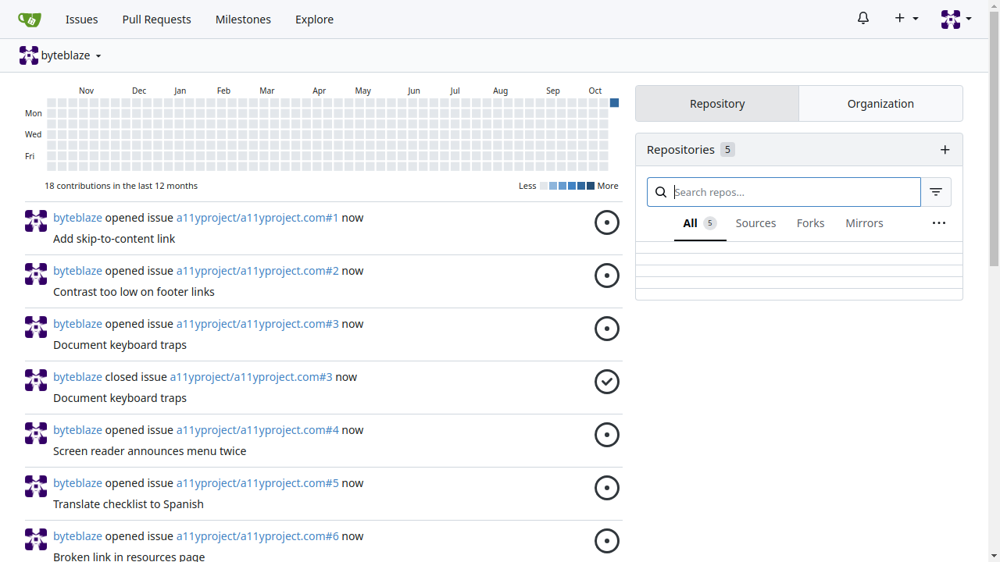
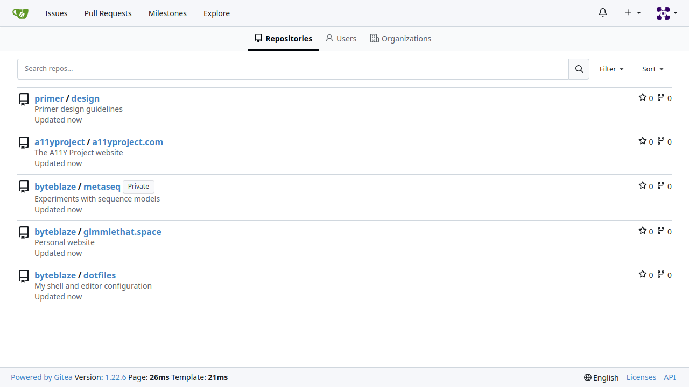
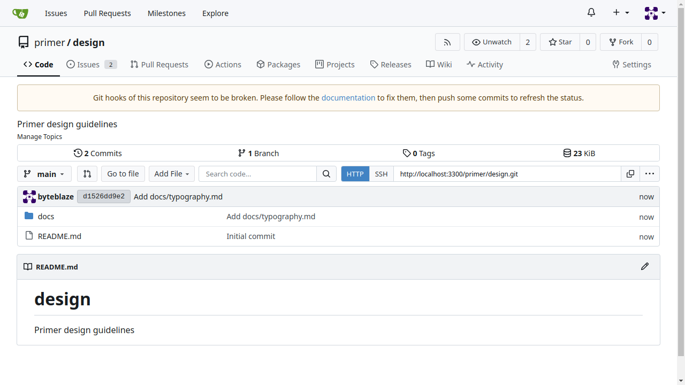
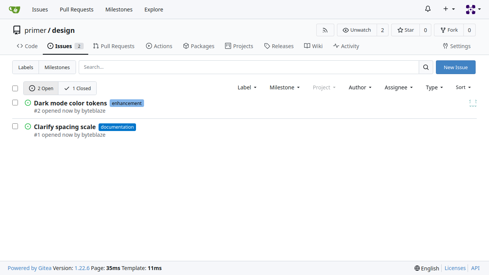
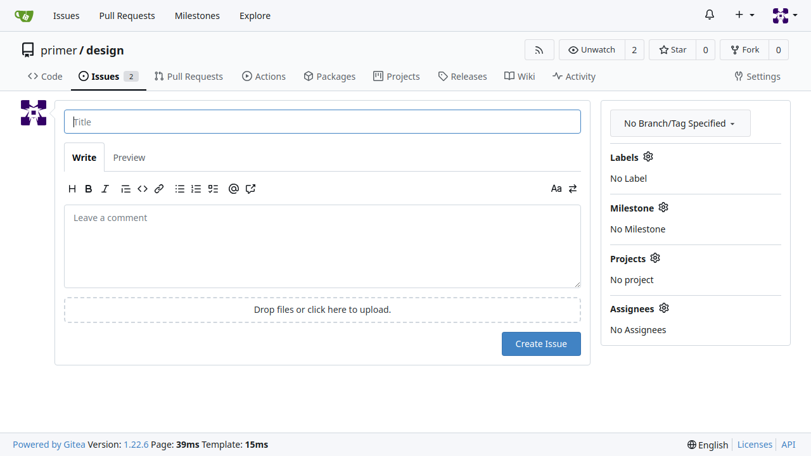
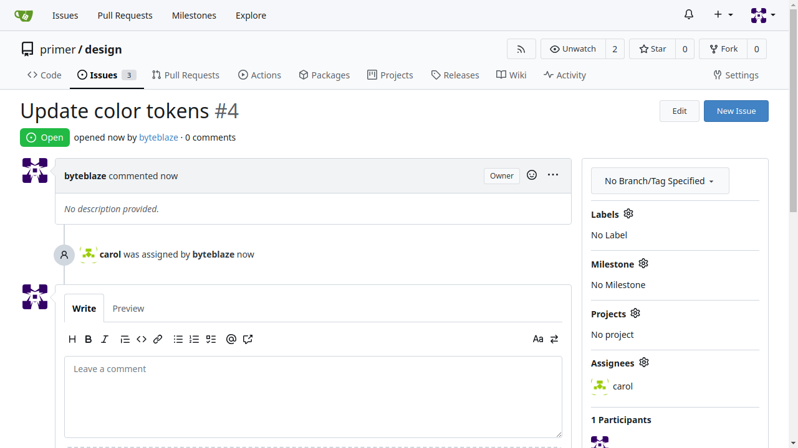

# Demo walkthrough: the graph composes a route the agent never walked

Run: `results/v2-broken/eval/2026-10-18_18-28-37_PathMemory-graph_on_pathmemory.issues-2_0` (trial 1 of 5, broken
UI, v2 memory). Goal: *Create an issue "Update color tokens" in primer/design and assign it to carol.*

**1. Dashboard, repository links hidden.** Memory's usual first step (`{owner}/{repo}` from the dashboard, learned
from 4 episodes) is not on the page. Replay does not guess: it bans that step for this run and asks FalkorDB again.
The new route joins steps from two separate training runs: `explore-3` (Explore → repo) and `issues-1`
(repo → Issues → New Issue). The query and per-hop sources are in [COMPOSITION.md](COMPOSITION.md).

**2. Replayed click: Explore** (no LLM call). Landed on `/explore/repos` as expected.

**3. Replayed click: `design`** in the Explore list (link name stored as `{repo}`, filled from the chosen binding;
its href `/primer/design` matches the chosen owner before the click). Landed on `/primer/design`; owner and repo
verified.

**4. Replayed clicks: Issues, then New Issue.** Each landing page verified (`/primer/design/issues`, then
`/primer/design/issues/new`).

**5. Handover.** The LLM gets a note that memory replayed navigation to this exact URL, then fills the title,
selects carol and presses Create Issue (4 LLM steps), and reports. Gitea's API confirms the issue and assignee.

Same task with the bridge step removed from a copy of the graph (ablation): FalkorDB returns no route after the
dashboard step fails, and the LLM finds its own way (5/5 successes, none by replay).

To show it live: `uv run pathmemory-ui` → Results tab lists the v2 runs (each cell replays a saved run). The live
tab still uses the demo graph `pathmemory` (v1 memory, unchanged).
